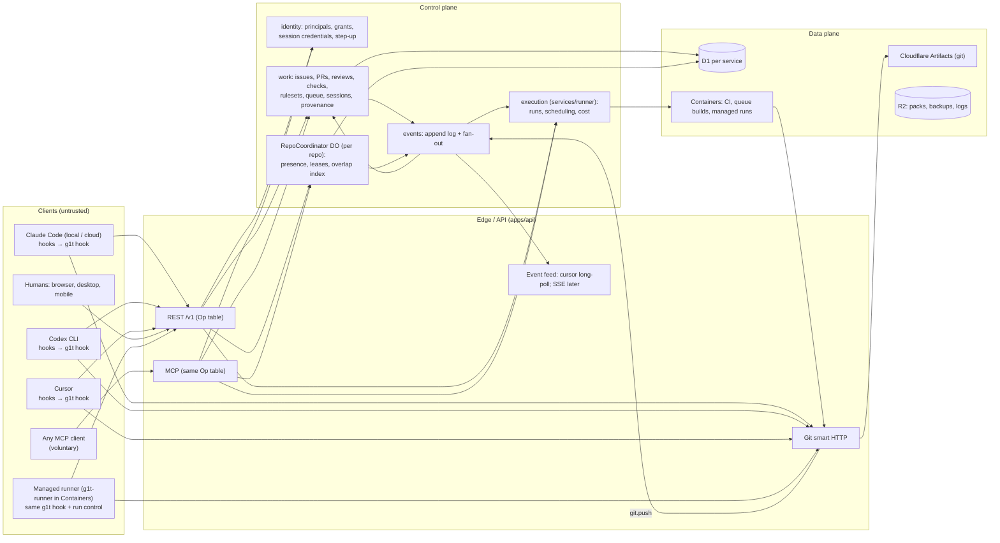
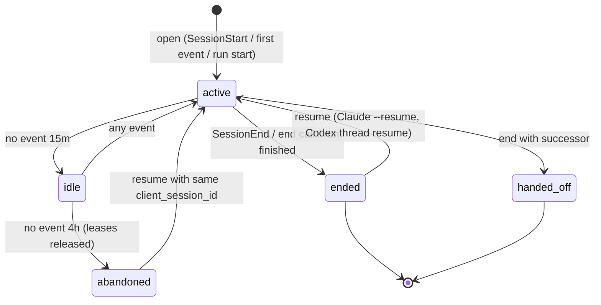
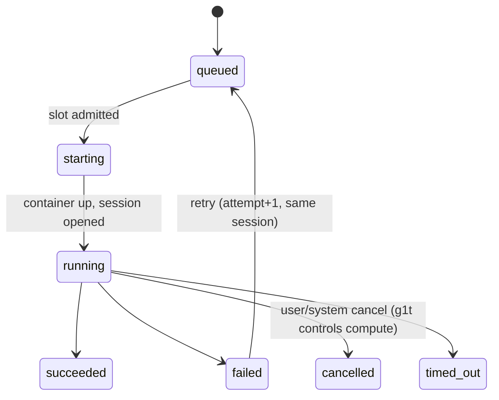

# g1t: agent-native architecture review

Status: proposal, not built. Written 2026-10-12 from the code at `bba76b3`.
Nothing here is documented behaviour; `apps/docs` remains the description of
what g1t does.

**Decision, 2026-10-12 (later the same day):** g1t no longer hosts agents.
The @g1t platform agent (assigning issues to g1t, @g1t mentions, plans,
reviews and revisions by g1t) and the workspace agents (personas, chat DMs,
skills, abilities, routines, computers, budgets, Customize), with the
models, context and agents services, were removed. g1t is the platform
coding agents integrate with: the MCP server, the REST API, OAuth apps,
access tokens, webhooks and runners. What this review calls managed
execution (option A, §II.3, Part XI, the runtime parts of Part XV and
Phase 4) is out of scope; read those parts as history. The harness-first
pieces it recommends that exist today stay: pull request sessions
(`record_session` / `read_session`), overlaps, the merge queue, required
checks and coding-agent attribution. Where a row below says **[built]**
about a hosted agent, that code is gone.

**Decision, 2026-10-13:** project and workspace memory (`recall` /
`remember`, the Memory pages and the `memory:*` scopes) was removed too:
harnesses keep their own memory, and shared knowledge belongs in
`AGENTS.md`/`CLAUDE.md`. Decision records stay. The `memories` table is
left in work's D1, no longer read or written; read the memory parts below
as history.

**Removed the same week:** GitHub mirroring (a repository comes across
from GitHub by importing it once; `services/repos/src/mirror.rs` is gone),
Boards and Roadmap, the org chart and reporting lines, get-started
checklists, preview stacks and project dependencies, and invite-only
registration. Wherever this review leans on mirroring as a live bridge to
GitHub, or on any of these, read it as history.

**Decision, 2026-10-17:** issues became workspace-level **work items**
(g1t #57). A work item belongs to the workspace, not to one repository, and
links any number of its repositories, each as `origin`, `target` or
`touched`; it closes once every target has landed. Work items and new pull
requests share one sequence of numbers per workspace. Sessions are still
recorded per checkout, against the repository they run in, but the work
item a session works on is the workspace's, and claims attach to the
workspace's work items, not to a repository. Pull requests, path overlaps
and the merge queue stay per repository. Wherever this review says
"issue", read work item; wherever it treats coordination around an issue
as per repository, read it as the workspace's.

Labels used throughout:

| Label          | Meaning                                                    |
| -------------- | ---------------------------------------------------------- |
| **[built]**    | Implemented and reachable on g1t.sh today                  |
| **[partial]**  | Implemented but incomplete, heuristic or narrow            |
| **[stub]**     | Types, flags or UI exist; behaviour does not               |
| **[claimed]**  | Stated in README/docs/marketing; not supported by the code |
| **[proposed]** | My recommendation                                          |

Provider facts (Claude Code, Codex, Cursor, Gemini CLI, Copilot) were
checked against vendor docs and, for Codex and Gemini CLI, against source at
recent commits. Cursor, the Cloudflare post and Cloudflare limits come from
secondary sources because this environment's network policy blocked those
hosts (and `g1t.sh` itself; see §13). Treat those rows as needing a
re-check before you build on them.

---

## Part I — Executive verdict

**g1t should be an agent-native Git forge (C) whose one genuinely new
primitive is the _session_: a first-class, provider-neutral record of a
unit of work by a human-sponsored agent, linked to commits by Git itself and
observed by deterministic client hooks. Coordination (B) is a thin layer of
that forge, not a product of its own. Managed execution (A) is just another
client of the session protocol that also happens to own compute.**

That is your hypothesis D in shape, but I disagree with it in three places:

1. **B is not a co-equal core.** As a separate "coordination platform"
   (claims, interface contracts, agent-to-agent messaging, semantic conflict
   detection), B is mostly premature and partly unsound: what can be
   detected deterministically is file overlap, Git conflicts and test
   failures, and the forge already computes the latter two. The coordination
   that is worth building now is _visibility of in-progress work before it
   becomes a PR_, delivered into the agent's context by hooks. That is a
   forge feature (an "Active work" view plus a per-repository lease table),
   not a platform.
2. **The biggest architectural problem is not missing coordination; it is
   that g1t is currently two products.** About a third of the backend and
   most of the positioning (README: "where a company's people and agents
   work together", chat, artifacts, agents hired into roles, an org chart,
   `@g1t` the orchestrator) is an _AI workforce/Slack_ product. The other
   ~60% is a good, unusually rigorous Git forge. Your prompt describes the
   second. The code and homepage lead with the first. Pick the forge.
3. **Managed execution is already closer to "just a client" than you
   think.** g1t's hosted coding agent does not have its own agent loop: it
   runs headless Claude Code in a Cloudflare Container that talks to g1t
   only through the public API, MCP and Git
   (`crates/runner/src/harness.rs:169`, `run_claude`). The coupling that
   makes it special lives in the _forge's data model_ (`pulls.agent`,
   `pulls.runtime`, `pulls.managed`, `pulls.stage`, `made_by_g1t()` in
   `services/work/src/lifecycle.rs:121`), not in the runtime. Unwinding that
   is a refactor, not a rewrite.

**What g1t should explicitly avoid becoming:**

- A chat/workforce platform with a forge attached (Slack + Devin + GitHub).
- An agent orchestrator that schedules and plans for other people's agents
  (`plans`, `hand_off`, `@g1t` routing).
- A transcript warehouse. Sessions should keep _summaries, provenance edges
  and bounded observed facts_, not full conversations.
- A proprietary memory system competing with `AGENTS.md`/`CLAUDE.md`.
- A coordinator on the hot path of every edit. Coordination must be
  advisory, cached locally and fail-open.

**Guiding principle for the rebuild:**

> **The commit is the unit of truth, the session is the unit of
> participation, the pull request is the unit of approval.**
> g1t trusts what it can verify (Git objects, check results, credentials),
> records what clients observe (hook events) with a trust label, and treats
> what models say as claims. Every agent, hosted or not, participates
> through the same session protocol.

---

## Part II — Current-state audit

### II.1 Shape of the system

- About 700k lines across 22 services and 8 apps. Rust for the core
  (identity, repos, work, events, billing, actions, security, packages,
  api). TypeScript for web, runner, agents, chat, artifacts, context and
  models.
- Every service is a Worker with its own D1 database. Services call each
  other through service bindings and fan events out through Queues.
- Self-host runs the same Workers under workerd/Miniflare
  (`deploy/self-host`). Runner-dependent features are off there: agents,
  merge-queue builds and hosted Actions jobs.

| Area                                                                                                                                            | Status                                                      | Where                                                                          |
| ----------------------------------------------------------------------------------------------------------------------------------------------- | ----------------------------------------------------------- | ------------------------------------------------------------------------------ |
| Git storage on Cloudflare Artifacts, sharded namespaces, R2 pack cache, nightly bundles, cold fallback                                          | [built]                                                     | `services/repos/src/{store,shards,pack_cache,backups,fallback}.rs`             |
| Smart HTTP (proxied to Artifacts), push checks: workflow gate, rulesets, secret push protection                                                 | [built]                                                     | `services/repos/src/{git_http,push_checks,workflow_gate,rules,secret_scan}.rs` |
| Repository size: 950 MB repo / 32 MB object / 100 MB push                                                                                       | [built] (hard limits)                                       | `services/repos/src/pack_limits.rs`                                            |
| Landing: fast-forward only; merge commits made earlier by catch-up                                                                              | [built]                                                     | `services/repos/src/land.rs:209`, `catch_up.rs`                                |
| Squash / rebase merges                                                                                                                          | [stub] (enum + validation; `merge_gate` hard-codes `Merge`) | `services/work/src/rulesets.rs:851`                                            |
| Issues, PRs, comments-as-reviews, labels, milestones, CODEOWNERS                                                                                | [built]                                                     | `services/work/migrations/*`                                                   |
| GitHub-compatible checks/statuses                                                                                                               | [built]                                                     | `services/work/migrations/0029_commit_checks.sql`                              |
| Rulesets incl. `applies_to: Everyone/Agents/People`, `count_agent_approvals`, `confidence_threshold`, `cost_cap`, `path_review`, `merge_window` | [built]                                                     | `crates/rules`, `crates/contracts/src/rules.rs:304,830`                        |
| Speculative merge queue (batches of ≤4, `g1t-queue/<id>`, in-order landing, eject + retest)                                                     | [built]                                                     | `services/work/src/queue.rs`, `0010_merge_queue.sql`                           |
| Actions engine (GitHub-compatible), self-hosted runner under Sysbox                                                                             | [built]                                                     | `services/actions`, `crates/actions`, `crates/runner`                          |
| Event bus: Queue → D1 append log → 16 subscriber queues; at-least-once, DLQ                                                                     | [built]                                                     | `services/events/src/lib.rs`, `crates/contracts/src/subscribers.rs`            |
| Webhooks with per-hook dedupe and retries over ~7.5 h                                                                                           | [built]                                                     | `services/webhooks/src/deliver.rs`                                             |
| Event stream or replay cursor for API clients                                                                                                   | absent                                                      | (log is queryable via `list_events`, no cursor/SSE)                            |
| PR file overlap ("overlaps" on `pull_request get`)                                                                                              | [partial] (file paths, PR↔PR only, after push)             | `services/work/src/reviews.rs:95`                                              |
| Mergeability precompute (disjoint-files fast path, sandbox probe)                                                                               | [built]                                                     | `services/work/src/mergeability.rs`                                            |

### II.2 External agent integration (the part that matters most)

| Capability                                                                                                                                             | Status                                                                                                                                              | Where / notes                                                                                          |
| ------------------------------------------------------------------------------------------------------------------------------------------------------ | --------------------------------------------------------------------------------------------------------------------------------------------------- | ------------------------------------------------------------------------------------------------------ |
| MCP server, streamable HTTP but stateless JSON replies; OAuth 2.1 + PKCE + dynamic client registration; PAT                                            | [built]                                                                                                                                             | `apps/api/src/{mcp,oauth}.rs`                                                                          |
| 20 MCP tools, ~380 actions, generated from the same `Op` table as REST/OpenAPI, so permissions/audit/billing are shared                                | [built]. This is a strong design worth keeping.                                                                                                     | `apps/api/src/{tools,operations,rest,openapi}.rs`                                                      |
| MCP resources/prompts                                                                                                                                  | absent                                                                                                                                              | capabilities = tools only                                                                              |
| `record_session` / `read_session`                                                                                                                      | [built] but **append-only log keyed to a PR**: no session id, actor, client, start/end                                                              | `services/work/migrations/0001_init.sql` `session_entries(pull_id, seq, kind, text, tool, commit, at)` |
| Only the PR owner may record                                                                                                                           | [built]                                                                                                                                             | `services/work/src/lib.rs:2432`, `Pull::is_owned_by`                                                   |
| Claude Code hook installer (`UserPromptSubmit`, `PostToolUse *`, `Stop`)                                                                               | [partial]                                                                                                                                           | `apps/web/public/install/{claude.sh,setup.mjs,hook.mjs}`                                               |
| ↳ records nothing until an open PR exists for the branch; caches a miss **permanently** (`~/.g1t/pulls.json`), so a PR opened later is never picked up | bug                                                                                                                                                 | `hook.mjs` `pullFor`                                                                                   |
| ↳ blocking network call on every tool use (10 s timeout), no offline spool, no idempotency key                                                         | design flaw                                                                                                                                         | `hook.mjs` `main`                                                                                      |
| ↳ sends raw `tool_response` (clipped to 4 kB) **without secret redaction**; installed into global `~/.claude/settings.json` so it fires in every repo  | security flaw                                                                                                                                       | `hook.mjs`, `setup.mjs`                                                                                |
| ↳ never sets `commit`, so the server stamps whatever head the PR had                                                                                   | accuracy flaw                                                                                                                                       | `hook.mjs`                                                                                             |
| why-blame                                                                                                                                              | [partial]: heuristic window from "Pushed <sha>" notes that only hosted runs write; for external sessions it pulls in all earlier entries            | `apps/web/app/routes/repo/why.ts`, `apps/web/app/lib/provenance.server.ts`                             |
| Coding-agent recognition from commit email / Co-authored-by                                                                                            | [built], display only                                                                                                                               | `crates/contracts/src/coding_agents.rs`, `apps/web/app/lib/commit-people.ts`                           |
| `g1t` CLI                                                                                                                                              | [built] **image push only**: no login, sessions or hooks                                                                                            | `crates/g1t/src/main.rs`                                                                               |
| Codex / Cursor / Gemini / Copilot adapters                                                                                                             | absent                                                                                                                                              | —                                                                                                      |
| "Any coding agent over MCP, recording its session onto its pull requests" (README)                                                                     | [claimed] in its general form: any agent _can_ call `record_session`, but only voluntarily, only after a PR exists, and only Claude Code has a hook | README.md                                                                                              |

### II.3 Two internal agent runtimes that don't share a model

**(A) The g1t coding agent ("assign an issue to g1t")** [built]

- `Op::AssignIssue` → `services/runner` `startImplement` → `work.openPull({agent:"g1t", runtime:"hosted"})`.
- `runCredential(onBehalfOf: actor)` then mints the token, and `AttemptSandbox` (Cloudflare Containers, not Sandbox SDK) runs `g1t-runner`.
- `g1t-runner` spawns `claude --print … --output-format stream-json --dangerously-skip-permissions` with g1t's MCP server, guard hooks (`PreToolUse`, `crates/runner/src/guard.rs`) and steer hooks (`PostToolUse`/`Stop` inject PR messages, `crates/runner/src/steer.rs`).
- `services/work/src/lifecycle.rs` `decide()` drives draft → review (second agent) → revise → catch-up → queue.
- Runs are recorded in **work's** D1 (`agent_runs`, `agent_messages`, `agent_waits`, `memories`, `plans`, `run_confidence`, `guardrails`).

**(B) Workspace agents ("hired" teammates, `@g1t` orchestrator)** [built]

- `services/agents`: a hand-written Anthropic Messages tool loop (`services/agents/src/turn.ts`) in a `Desk` Durable Object per agent, driven by chat.
- Its own sessions (`agent_sessions` with tree/payer/inbox/context), its own memory (`agent_memories`), routines, skills, marketplaces, plugins, connectors and budgets.
- It **cannot open PRs or start coding runs**: abilities `g1t:pulls`, `g1t:merge` and `g1t:deploy` have `tools: []` [stub] (`packages/contracts/src/abilities.ts`).

So "session" means three unrelated things: `agent_sessions` (chat-born work
of workspace agents), `agent_runs` (sandboxes) and `session_entries` (a PR's
log). None of them can represent _the founder's Claude Code session that
hasn't produced a PR_.

### II.4 Identity and authority: one significant hole

- g1t's own agent and workspace agents are well modelled.
  - `User.acting = Acting { agent, on_behalf_of, scope: AgentScope }` (`crates/contracts/src/credentials.rs`).
  - Run credentials are intersected with the sponsor's live rights, capped at 6 h and revoked at stop (`services/identity/src/run_credentials.rs`).
  - Audit records `ActorKind::Agent` with `on_behalf_of`.
- **External agents are indistinguishable from their human.**
  - An OAuth grant from Claude Code, or a PAT, never sets `acting` (`services/identity/src/oauth.rs`, `tokens.rs`), so `rules::is_agent` returns false (`crates/contracts/src/rules.rs:1329`).
  - A review is only treated as an agent's if `reviewer_id == AGENT_ID` (`services/work/src/rulesets.rs:184`).
  - Consequence: **a local Claude Code session holding the founder's MCP grant can approve a colleague's protected PR, and that approval counts as the founder's.**
  - `agent_change()` falls back on the _self-reported_ free-text `pulls.agent` field (`rulesets.rs:176-181`).
  - This is the most important correctness issue in the audit, and it gets worse the more you succeed at bringing external agents in.

### II.5 Memory and context: three overlapping systems

| System                  | What it holds                                                                    | Where                             |
| ----------------------- | -------------------------------------------------------------------------------- | --------------------------------- |
| Work `memories`         | Per repo or workspace; candidates/kept; confidence; fingerprints; sources        | `0015`, `0019_memory_capture.sql` |
| Agents `agent_memories` | Workspace/channel/person scopes                                                  | `services/agents/src/memory.ts`   |
| `services/context`      | Catalog, Vectorize search, scorecards, `runcontext.ts` injected into hosted runs | `services/context`                |

- The repository itself has **no `AGENTS.md` or `CLAUDE.md`**, even though the docs recommend one (`guides/bring-your-own-agent.mdx`).
- That is the clearest dogfooding signal in the repo: the knowledge your Claude Code sessions use to build g1t lives in commit messages and in your head, not in any of g1t's three memory systems.

### II.6 Dogfooding reality, from this very session

- This checkout's `origin` is `github.com/flagon-io/g1t`.
  - 43 of the last 127 commits are authored by Claude, with `Claude-Session:` trailers pointing at claude.ai cloud sessions.
  - Claude Code cloud sessions can only clone from and push to GitHub. Other hosts get a read-only bundle.
- So today your cloud agents **cannot push to g1t at all**. g1t sees their work only through the GitHub mirror (`services/repos/src/mirror.rs`, integrations' takeover/hand-back).
- The commit trailers your agents already write (`Claude-Session: https://claude.ai/code/session_…`) are a provenance channel g1t ignores today.
- The sandbox network policy used for this review could not reach `g1t.sh`, `api.g1t.sh` or `docs.g1t.sh`. A cloud agent with a default network policy cannot call g1t's MCP server or hooks unless the environment allowlists g1t.

**Implication: Phase 1 must work for a GitHub-mirrored repository and for
agents that reach g1t only intermittently.** "Push to g1t" cannot be a
prerequisite for g1t being useful.

### II.7 Accidental complexity and coupling

1. Agent lifecycle is baked into `pulls`: `agent`, `runtime`, `managed`, `stage`, `stage_detail`, `revisions`, `working_on`, `working_until`, `stalled`. This makes "g1t-made" PRs a different species from human/external PRs.
2. Agent run state lives in `services/work` (forge D1), workspace-agent state in `services/agents`, and `services/agents` imports source files from `services/runner` (`model-env.ts`, `hosted.ts`). Routing config is duplicated across two wrangler files.
3. Billing is deeply agent-aware (`attribution.rs` stamps agent handle on ledger lines). That is fine for managed runs, but must never be needed for external sessions.
4. Three memory systems, three session concepts, two agent identity models (`Acting` vs. `AskerAccess`).
5. `apps/web` is 152k lines, larger than any backend, with WebSockets for chat, notify and artifacts but polling for agent sessions.

---

## Part III — Recommended architecture

### III.1 The four options, judged

| Option                                    | Verdict                                         | Why                                                                                                                                                                                                                         |
| ----------------------------------------- | ----------------------------------------------- | --------------------------------------------------------------------------------------------------------------------------------------------------------------------------------------------------------------------------- |
| **A. Execution platform**                 | Reject as the core; keep as an optional adapter | Commodity and capital-intensive. Anthropic, OpenAI, Cursor, GitHub and Cloudflare all sell sandboxes plus agents. Your own use proves the agent of choice lives elsewhere.                                                  |
| **B. Coordination platform (standalone)** | Reject as a separate product                    | Without the repository, PRs, checks and approvals, coordination has nothing authoritative to coordinate against. It becomes a chat bus or a task tracker (Linear, Jira and Copilot's Agents tab already exist).             |
| **C. Agent-native forge**                 | **Core**                                        | The forge already owns the things agents cannot fake: refs, diffs, checks, rulesets, approvals and the merge queue. Making sessions and agent identity native to it is new, defensible, and useful with zero hosted agents. |
| **D. Combination**                        | Yes, as **C ⊃ B-lite, A as a client**           | Not three products with three architectures: one forge, one session protocol, and an execution adapter that speaks it.                                                                                                      |

### III.2 Where "separate the agent from the platform" breaks down

The principle is right. It breaks in four specific places, and the design
should name them rather than paper over them:

1. **Control.** g1t can stop a managed run (kill the container, revoke the credential). For an external session it can only _revoke the session credential_ and _ask_, through hook-injected context. The protocol must expose `capabilities` per session (`can_cancel`, `can_steer`) rather than pretend.
2. **Observation fidelity.**
   - Managed runs give g1t the full stream-json and exact cost.
   - Local Claude Code gives hook events that an honest client observed: tool names, file paths, Bash commands and `session_id`.
   - Codex and Cursor give somewhat less.
   - An MCP-only client gives only what the model chooses to say.
   - The data model needs a `source` and `trust` on every observed fact.
3. **Credentials.** A managed run gets a short-lived credential g1t mints. A local agent runs as the developer's OS user and can read `~/.g1t/config.json` and the Git credential helper. g1t can distinguish _credentials_, never _processes_. Authority rules must therefore rest on credential type plus step-up for human-only acts (§III.6), not on trusting the client to say it is an agent.
4. **Lifecycle automation** (auto-revise on failing checks, auto-review, catch-up) is a policy that needs something to _execute_. For a managed run g1t executes it. For an external session the same policy can only _notify_ the session's client, or start a managed run. Put the policy on the PR and the executor behind an interface.

### III.3 System diagram



### III.4 Responsibilities and data ownership

| Component                         | Owns (authoritative)                                                                                          | Does not own                                 |
| --------------------------------- | ------------------------------------------------------------------------------------------------------------- | -------------------------------------------- |
| **Git / Artifacts**               | Source, refs, commit graph, trailers                                                                          | Anything about who _ran_ what                |
| **identity**                      | Principals, grants, session credentials, client registrations, step-up state                                  | Session content                              |
| **work**                          | Issues, PRs, reviews, checks, rulesets, merge queue, **sessions, session events (bounded), provenance edges** | Live leases (it reads them)                  |
| **RepoCoordinator DO** [proposed] | Live presence and leases for one repo, plus the overlap index of in-flight paths. Snapshotted to D1.          | Durable history (events do that)             |
| **events**                        | Ordered append log per stream; fan-out; replay cursor                                                         | Business state                               |
| **execution** (`services/runner`) | Runs: compute, credentials it minted, cancellation, cost                                                      | Sessions (it _creates_ them like any client) |
| **agents / chat / artifacts**     | Frozen (Part VIII)                                                                                            | —                                            |

Why sessions live in `work` and not a new service:

- They join to PRs, issues and commits constantly.
- `work` already owns `session_entries` and `agent_runs`.
- A new service would add a network round trip to every PR page.

Split them out later only if volume demands it.

### III.5 Control plane vs. data plane

- **Data plane:** Git objects (Artifacts), CI and run containers, logs and packs (R2). High volume, eventually consistent from the control plane's point of view, never trusted for authorization.
- **Control plane:** small transactional records in D1 plus per-repo Durable Objects for the few things that need linearizability (leases, presence, the queue's head if it ever needs it). Every control-plane write is idempotent by client-supplied key.

### III.6 Identity and permission model

Four distinct concepts, which the code currently conflates for external
agents:

| Concept           | Definition                                     | Representation                                                                                                                                                                                              |
| ----------------- | ---------------------------------------------- | ----------------------------------------------------------------------------------------------------------------------------------------------------------------------------------------------------------- |
| **Principal**     | Who is accountable                             | A human `User` or a workspace (service account). Never an agent.                                                                                                                                            |
| **Agent client**  | What software is acting                        | `{provider, product, version}` on the grant and the session. Descriptive and self-declared, so not a security boundary.                                                                                     |
| **Delegation**    | A principal letting a client act within limits | A _session credential_ [proposed]: `Acting { agent: client, on_behalf_of: principal, scope }`. This is the type that already exists in `crates/contracts/src/credentials.rs`, extended to external clients. |
| **Authorization** | What a request may do                          | Intersection of principal rights × credential scope × rule constraints for agent actors.                                                                                                                    |

Rules [proposed]:

1. Every OAuth grant issued to an MCP client or to the `g1t` CLI's agent flow is an **agent grant**. Its tokens resolve to `User { acting: Some(..) }`, so `is_agent()` is true and rulesets with `applies_to: Agents` apply. That one change makes external agents real participants under existing rules.
   - PATs stay human by default.
   - A PAT used through the hook or MCP is still a human credential. That is a known gap, closed by rule 2, not by detection.
2. **Human-only acts require an interactive human credential:**
   - approving a PR (counting toward required approvals or CODEOWNERS),
   - bypassing a rule,
   - changing rulesets or branch protection,
   - creating or reading secrets,
   - production deploy approval,
   - minting tokens.

   "Interactive human credential" means a browser or desktop session, or a PAT marked `human_interactive` used with a recent WebAuthn/TOTP step-up (e.g. within 12 h). A compromised laptop agent can still click through a browser it controls. Nothing at the forge prevents that, and the review should say so.

3. Agent approvals are recorded, shown and _never_ count unless the ruleset sets `count_agent_approvals` (existing flag), and never for the PR's own sponsor.
4. **Self-approval is forbidden by principal, not by client.** An agent acting for Alice cannot approve Alice's PR, and Alice can't approve a PR whose sessions she sponsored if the ruleset requires an independent reviewer.
5. Session credentials are scoped to one workspace and an explicit repo set, expire (default 12 h, renewable while active) and are revocable from the session page.

### III.7 Consistency guarantees

| Data                           | Guarantee                                                                                                                               |
| ------------------------------ | --------------------------------------------------------------------------------------------------------------------------------------- |
| Refs, merges, queue landing    | Linearizable per ref (Artifacts compare-and-swap, fast-forward land). Unchanged.                                                        |
| Session creation, close, link  | Idempotent upsert by `(principal, client_session_id)`. Read-your-writes per request.                                                    |
| Session events                 | At-least-once from client; deduped by `(session_id, client_seq)`. Ordered per session by `client_seq`, not across sessions.             |
| Leases                         | Linearizable per repo (one DO). TTL expiry is authoritative only at the DO. Clients see eventually consistent copies (≤ a few seconds). |
| Overlap / conflict hints       | Eventually consistent, advisory, may be stale. Never block a push or merge on them.                                                     |
| Provenance edges from trailers | Derived from Git at push time. Recomputable from Git alone.                                                                             |
| Event feed                     | At-least-once, per-repo ordering by log id, replayable for retention window (proposed 7 days).                                          |

---

## Part IV — Domain model

### IV.1 Which concepts get entities

| Concept                  | Entity?                   | Decision                                                                                                  |
| ------------------------ | ------------------------- | --------------------------------------------------------------------------------------------------------- |
| **Commit**               | Git                       | Never duplicate. Store only edges _to_ SHAs.                                                              |
| **Changeset**            | No                        | A branch + head SHA + base SHA is the changeset. Git has it.                                              |
| **Pull request**         | Yes (exists)              | Remains _the_ approval and integration artifact. Strip the agent-lifecycle columns into a separate table. |
| **Issue**                | Yes (exists)              | Is the intent _and_ the task. Sub-issues and `blocked_by` (exists) cover decomposition.                   |
| **Intent**               | No                        | An issue, or a session's `goal` text. A separate entity adds a concept nobody maintains.                  |
| **Task**                 | No                        | An issue. If you need "a task an agent claimed", that is a lease on an issue.                             |
| **Session**              | **Yes, new**              | The unit of participation; may never produce a commit.                                                    |
| **Run**                  | Yes (rename `agent_runs`) | Exists only for managed execution: compute g1t controls and bills. A run _serves_ a session.              |
| **Session event**        | Yes, bounded              | Observed or reported facts with source and trust. Not a transcript.                                       |
| **Lease (claim)**        | Yes, lives in the DO      | Advisory, TTL'd, owned by a session.                                                                      |
| **Provenance edge**      | Yes, link tables          | `session_commits`, `session_links` (issue/PR), `pull_heads`.                                              |
| **Contract / decision**  | No                        | Files in the repo (OpenAPI, `.proto`, ADRs) guarded by CODEOWNERS/path rules.                             |
| **Integration frontier** | No                        | Merge queue + speculative batches (exists).                                                               |

### IV.2 TypeScript interfaces

These mirror into Rust contracts in `crates/contracts/src/work.rs` and
`packages/contracts/src/work.ts`.

```ts
// ---------- identity ----------
type PrincipalRef = { kind: "user" | "workspace"; id: string; name: string };

/** Self-declared; descriptive only. */
interface AgentClient {
  provider: "anthropic" | "openai" | "cursor" | "google" | "github" | "g1t" | "other";
  product: string; // "claude-code", "codex-cli", "cursor", "gemini-cli", "g1t-runner"
  version?: string;
  adapter?: string; // "g1t-hook/0.3.0" – our code, so slightly more trustworthy
}

interface SessionCredential {
  // extends existing Acting
  id: string; // cred_…
  principal: PrincipalRef; // on_behalf_of
  client: AgentClient;
  workspace: string;
  repos: string[]; // explicit; [] = none
  scopes: string[]; // ⊆ grant scopes ⊆ principal rights
  sessionId?: string; // bound once the session is opened
  expiresAt: string;
  revokedAt?: string;
}

// ---------- sessions ----------
type Execution =
  | { kind: "local"; host?: string /* hashed hostname, optional */ }
  | { kind: "remote"; vendor: string; url?: string /* e.g. claude.ai session URL */ }
  | { kind: "managed"; runId: string };

type SessionState =
  | "active" // event within idle window
  | "idle" // no event for > 15 min
  | "ended" // SessionEnd / explicit end
  | "abandoned" // no event for > lease max (default 4 h); leases released
  | "handed_off"; // ended with a successor session

interface Session {
  id: string; // ses_… (ULID)
  workspace: string;
  repoId: string | null; // null allowed: investigation outside any g1t repo isn't recorded at all
  principal: PrincipalRef; // AUTHORITATIVE (from credential)
  client: AgentClient; // SELF-REPORTED
  clientSessionId: string; // provider's id (Claude session_id, Codex thread id). SELF-REPORTED, unique per principal
  execution: Execution; // managed: AUTHORITATIVE; else SELF-REPORTED
  parentId?: string; // subagent or handoff source
  state: SessionState; // DERIVED (server)
  title?: string; // REPORTED (model/human)
  goal?: string; // REPORTED
  summary?: string; // REPORTED, shown with "agent's account" label
  // Git position: last OBSERVED by the client adapter (git rev-parse), verified when SHA appears in a push
  branch?: string;
  baseSha?: string; // merge-base with default branch when started / last seen
  headSha?: string;
  touchedPaths: string[]; // OBSERVED by client hooks (Edit/Write/patch), capped 500, repo-relative
  capabilities: { cancel: boolean; steer: boolean; costExact: boolean }; // DERIVED from execution+adapter
  usage?: { inputTokens?: number; outputTokens?: number; costUsd?: number; exact: boolean }; // managed: exact
  visibility: "repo" | "private"; // private: only principal + admins (investigations)
  startedAt: string;
  lastEventAt: string;
  endedAt?: string;
}

/** Edges. Rows, not a graph DB. */
interface SessionLink {
  sessionId: string;
  target: { kind: "issue" | "pull"; repoId: string; number: number };
  source: "explicit" | "branch" | "commit_trailer" | "managed";
  createdAt: string;
}

interface SessionCommit {
  sessionId: string;
  repoId: string;
  sha: string;
  source: "trailer" | "hook_observed" | "managed"; // trailer = verifiable in git
  observedAt: string;
}

/** Every head a PR has ever had: survives force-push and rebase. */
interface PullHead {
  pullId: string;
  sha: string;
  pushedBy: string;
  pushedAt: string;
  forced: boolean;
}

// ---------- session events (bounded, typed, not a transcript) ----------
type Trust = "verified" | "observed" | "reported";
// verified: g1t checked it (a SHA exists, a check passed)
// observed: an adapter saw it deterministically (hook) – honest-client assumption
// reported: model/user text

type SessionEventKind =
  | "lifecycle" // start, resume, compact, end, stop_failure
  | "prompt" // OFF by default; opt-in per repo, redacted
  | "tool" // {tool, target (path/cmd head), ok, durationMs} – no outputs
  | "files" // {paths[], op: edit|write|delete}
  | "git" // {op: commit|push|checkout|rebase, sha?, branch?}
  | "note" // model or human text: decisions, blockers, summary
  | "lease" // acquired/renewed/released (mirrors DO)
  | "warning"; // server → session: overlap, behind, failing check (echoed for audit)

interface SessionEvent {
  sessionId: string;
  seq: number; // client-assigned, monotonic per session; dedupe key
  kind: SessionEventKind;
  trust: Trust;
  source: "hook" | "mcp" | "api" | "runner" | "server";
  at: string; // client clock; server stores receivedAt too
  data: Record<string, unknown>; // ≤ 4 KB after redaction
}

// ---------- coordination ----------
type LeaseTarget = { kind: "issue"; number: number } | { kind: "paths"; globs: string[] }; // e.g. ["services/work/src/queue.rs", "crates/rules/**"]

interface Lease {
  id: string; // lse_…
  repoId: string;
  sessionId: string;
  principal: PrincipalRef;
  target: LeaseTarget;
  mode: "advisory"; // exclusive is NOT offered (see Part VII)
  note?: string; // "changing merge_gate signature"
  acquiredAt: string;
  expiresAt: string; // ≤ 30 min; renewed by any session event
}

interface Overlap {
  // computed, never stored as truth
  withSession?: string;
  withPull?: number;
  paths: string[];
  kind: "lease" | "touched" | "pr_diff";
  freshness: string; // when computed
}

// ---------- managed execution ----------
type RunState = "queued" | "starting" | "running" | "succeeded" | "failed" | "cancelled" | "timed_out";
interface Run {
  id: string; // run_…
  sessionId: string; // every run serves exactly one session; a session may have many runs (retries)
  workspace: string;
  repoId: string;
  kind: "implement" | "revise" | "review" | "update" | "answer" | "plan";
  executor: { image: string; agent: AgentClient; model?: string; size: string; where: "cloudflare" | "self_hosted" };
  state: RunState;
  attempt: number;
  timeoutAt: string;
  costUsd?: number; // exact, from model proxy
  sandboxSeconds?: number;
  error?: string;
  createdAt: string;
  startedAt?: string;
  finishedAt?: string;
}

// ---------- PR automation, moved off `pulls` ----------
interface PullAutomation {
  // replaces pulls.managed/stage/revisions/working_*/stalled
  pullId: string;
  policy: "none" | "notify_session" | "managed_revise";
  stage?: string;
  revisions: number;
  workingRunId?: string;
  stalled?: string;
}
```

### IV.3 SQL (D1, `g1t-work`): additive migrations only

```sql
CREATE TABLE sessions (
  id TEXT PRIMARY KEY, workspace TEXT NOT NULL, repo_id TEXT,
  principal_id TEXT NOT NULL, principal_name TEXT NOT NULL,
  client TEXT NOT NULL,                 -- JSON AgentClient
  client_session_id TEXT NOT NULL,
  execution TEXT NOT NULL,              -- JSON
  parent_id TEXT, state TEXT NOT NULL, title TEXT, goal TEXT, summary TEXT,
  branch TEXT, base_sha TEXT, head_sha TEXT,
  touched_paths TEXT NOT NULL DEFAULT '[]',
  usage TEXT, visibility TEXT NOT NULL DEFAULT 'repo',
  started_at TEXT NOT NULL, last_event_at TEXT NOT NULL, ended_at TEXT,
  UNIQUE (principal_id, client_session_id)
);
CREATE INDEX sessions_active ON sessions (repo_id, state, last_event_at);
CREATE INDEX sessions_branch ON sessions (repo_id, branch);

CREATE TABLE session_events (
  session_id TEXT NOT NULL, seq INTEGER NOT NULL, kind TEXT NOT NULL,
  trust TEXT NOT NULL, source TEXT NOT NULL, at TEXT NOT NULL,
  received_at TEXT NOT NULL, data TEXT NOT NULL,
  PRIMARY KEY (session_id, seq)
);                                       -- retention: 90 days default; summaries/links kept

CREATE TABLE session_links (
  session_id TEXT NOT NULL, kind TEXT NOT NULL, repo_id TEXT NOT NULL, number INTEGER NOT NULL,
  source TEXT NOT NULL, created_at TEXT NOT NULL,
  PRIMARY KEY (session_id, kind, repo_id, number)
);
CREATE INDEX session_links_target ON session_links (repo_id, kind, number);

CREATE TABLE session_commits (
  session_id TEXT NOT NULL, repo_id TEXT NOT NULL, sha TEXT NOT NULL,
  source TEXT NOT NULL, observed_at TEXT NOT NULL,
  PRIMARY KEY (repo_id, sha, session_id)
);

CREATE TABLE pull_heads (
  pull_id TEXT NOT NULL, sha TEXT NOT NULL, pushed_by TEXT, pushed_at TEXT NOT NULL,
  forced INTEGER NOT NULL DEFAULT 0, PRIMARY KEY (pull_id, sha)
);
```

- `session_entries` stays read-only for old PRs.
- `record_session` becomes a shim: it finds or creates the session linked to the PR and appends `note` events.

### IV.4 Lifecycles





A PR's lifecycle is unchanged. Sessions attach to it; they never gate it.

---

## Part V — External agent protocol

### V.1 Layering

| Layer                    | Role                                                                                            | Primary or adapter?                                                                                        |
| ------------------------ | ----------------------------------------------------------------------------------------------- | ---------------------------------------------------------------------------------------------------------- |
| **Git**                  | Code transport, branches, commits, **trailers as provenance** (`G1t-Session: ses_…`)            | Primary, unchanged                                                                                         |
| **REST `/v1/sessions…`** | Deterministic integration surface for adapters, daemons and runners. No model involvement.      | **Primary**                                                                                                |
| **`g1t` CLI**            | Auth, repo detection, hook adapter for every provider, local spool, Git hook installer          | **Essential.** Hooks need a fast, local, offline-tolerant executable; a script piping to `curl` isn't one. |
| **MCP**                  | Discovery, context reads, voluntary structured reports (notes, leases, links), platform actions | **Convenience adapter** over the same `Op`s. Never the only path for anything that must be reliable.       |
| **Event feed**           | Clients and integrations learn what changed                                                     | Small: cursor long-poll                                                                                    |

Why MCP is not primary:

- Every MCP call depends on the model deciding to make it. The current docs admit it: "it has to remember to."
- Session open and close, file touches, commits and pushes must be captured by hooks.
- MCP remains excellent for _reading_ (context, active work, PR state) and for _intentional_ acts (claim this issue, record this decision, open this PR).

### V.2 Authentication

1. `g1t login` runs the device flow (exists: `/device/code`, `/device/token`). It produces an **agent grant** (refresh token in the OS keychain, falling back to `~/.g1t/credentials` at mode 0600).
2. On session open, the CLI exchanges the grant for a **session credential** bound to `(workspace, repos, session)`, valid for 12 h and renewable. Hooks and MCP use it.
3. For managed runs, `services/runner` mints the session credential directly (today's `runCredential`).
4. For cloud agents (Claude Code on the web, Codex cloud):
   - set `G1T_TOKEN` as an environment secret holding a **workspace-scoped agent token** limited to named repos,
   - allowlist `api.g1t.sh` in the environment's network policy,
   - document both steps.

### V.3 Endpoints

All take `Idempotency-Key`, all return `ETag` where meaningful, and all are
mirrored as MCP actions on a new `session` tool.

```http
POST /v1/sessions                       open or resume (upsert by client_session_id)
POST /v1/sessions/{id}/events           batch append (≤200), dedupe by seq
POST /v1/sessions/{id}/links            link issue/PR
POST /v1/sessions/{id}/end              end (optional successor for handoff)
GET  /v1/sessions/{id}                  read
GET  /v1/repos/{o}/{r}/activity         active sessions + leases + overlaps for this repo (the "board")
POST /v1/repos/{o}/{r}/leases           acquire/renew advisory lease
DELETE /v1/leases/{id}                  release
GET  /v1/repos/{o}/{r}/events?after=…   cursor feed (long-poll ≤25 s)
GET  /v1/repos/{o}/{r}/context          what an agent should know at start (§X)
```

**Open or resume:**

```http
POST /v1/sessions
Authorization: Bearer g1s_…            (agent grant or session credential)
Idempotency-Key: claude:4f1c…:open
Content-Type: application/json

{
  "client": { "provider": "anthropic", "product": "claude-code", "version": "2.3.1", "adapter": "g1t-hook/0.1.0" },
  "client_session_id": "4f1c9e2a-…",
  "execution": { "kind": "local" },
  "repo": { "remote": "https://github.com/flagon-io/g1t.git" },   // resolved to the g1t mirror server-side
  "git": { "branch": "claude/bold-sagan", "head": "bba76b3…", "base": "bba76b3…" },
  "parent_client_session_id": null
}
```

```json
{
  "session": { "id": "ses_01JA…", "state": "active", "repo": "flagon-io/g1t", "capabilities": { "cancel": false, "steer": true, "costExact": false } },
  "credential": { "token": "g1s_…", "expires_at": "2026-10-13T02:00:00Z" },
  "trailer": "G1t-Session: ses_01JA…",
  "context": {
    "active": [
      {
        "session": "ses_01J9…",
        "who": "syntaqx · codex-cli",
        "branch": "fix/queue-retest",
        "touched": ["services/work/src/queue.rs"],
        "issue": 412,
        "last": "2m"
      }
    ],
    "open_pulls_touching_hot_paths": [{ "number": 418, "paths": ["crates/rules/src/merge.rs"] }],
    "default_branch_failing": [],
    "instructions": ["AGENTS.md"]
  },
  "feed_cursor": "evt_01JA…"
}
```

- `repo.remote` may point at GitHub. The server resolves it to the g1t repository whose mirror config names that remote. If none exists, it answers `404 repo_not_on_g1t` and the adapter stays silent.
- An unauthorised repo returns the same 404, so the response does not reveal that the repository exists.

**Append events:**

```http
POST /v1/sessions/ses_01JA…/events
Idempotency-Key: ses_01JA…:17-24

{ "events": [
  { "seq": 17, "kind": "files", "trust": "observed", "source": "hook", "at": "…",
    "data": { "op": "edit", "paths": ["services/work/src/queue.rs"] } },
  { "seq": 18, "kind": "tool", "trust": "observed", "source": "hook", "at": "…",
    "data": { "tool": "Bash", "target": "cargo test -p g1t-work", "ok": false, "durationMs": 48211 } },
  { "seq": 19, "kind": "git", "trust": "observed", "source": "hook", "at": "…",
    "data": { "op": "commit", "sha": "9c2e…", "branch": "claude/bold-sagan" } }
]}
```

```json
{
  "accepted": [17, 18, 19],
  "duplicates": [],
  "next_seq": 20,
  "advice": [
    {
      "kind": "overlap",
      "paths": ["services/work/src/queue.rs"],
      "with": { "session": "ses_01J9…", "who": "syntaqx · codex-cli", "lease_note": "changing retest ordering" },
      "freshness": "2026-10-12T15:02:11Z"
    }
  ]
}
```

- `advice` is how the server talks back without a socket. The adapter turns it into hook output (`additionalContext`) on the next hook call.
- Clients never block on it.

**Lease:**

```json
POST /v1/repos/flagon-io/g1t/leases
{ "session": "ses_01JA…", "target": { "kind": "paths", "globs": ["services/work/src/queue.rs"] },
  "note": "changing retest ordering", "ttl_seconds": 1800 }
→ 201 { "lease": { "id": "lse_…", "expires_at": "…" },
        "conflicts": [ { "lease": "lse_…", "session": "ses_01J9…", "globs": ["services/work/**"] } ] }
```

The lease is granted even when it conflicts, because it is advisory. The
caller is told about the conflict.

### V.4 Failure handling and reconnection

| Failure                        | Behaviour                                                                                                                                                                                                                                                     |
| ------------------------------ | ------------------------------------------------------------------------------------------------------------------------------------------------------------------------------------------------------------------------------------------------------------- |
| Network down                   | The CLI appends to `~/.g1t/spool/<session>.ndjson` and returns immediately (hooks are never slower than ~20 ms locally). A detached flusher retries with backoff. Advice comes from the last cached `activity` snapshot, marked stale.                        |
| Duplicate delivery             | Server dedupes on `(session_id, seq)`; open dedupes on `(principal, client_session_id)`.                                                                                                                                                                      |
| Clock skew                     | `at` is the client's; ordering uses `seq`; `received_at` is the server's.                                                                                                                                                                                     |
| Laptop sleeps / process killed | No `SessionEnd`. The server derives `idle` at 15 min and `abandoned` at 4 h, and leases expire at their TTL (≤ 30 min unless renewed by events). Resume with the same `client_session_id` reattaches.                                                         |
| Credential expired mid-session | The CLI silently re-exchanges the grant. If the grant was revoked, the spool is discarded after 24 h and the user is told on next `g1t status`.                                                                                                               |
| Malicious client               | Can only lie about its _own_ sessions' reported/observed fields, inside its principal's repos. It cannot affect approvals (§III.6). Its overlap claims are labelled with who made them. Rate limits apply per credential (events ≤ 20/s, leases ≤ 50 active). |
| Secrets in events              | Redaction runs **client-side** (the existing `crates/scan` patterns compiled into the CLI) and **again server-side**. Tool outputs are never sent; only tool name, target head and status. Prompt capture is opt-in per repository and per user.              |

### V.5 Events feed (smallest useful)

- **Keep webhooks** as they are.
- **Add:** `GET /v1/repos/{o}/{r}/events?after=<id>&types=…`.
  - It reads the existing D1 `events` log, whose ids are already time-sortable.
  - It long-polls up to 25 s, returns ≤ 500 events and a `next` cursor, and keeps 7 days.
  - This gives replay, reconnection and at-least-once delivery for free from the existing log.
- **Later, only if needed:** SSE served by the RepoCoordinator DO for the web "Active work" panel. No WebSockets for agents: agents don't hold sockets, and hooks are request/response.

---

## Part VI — Claude Code integration

### VI.1 What Claude Code actually offers (relevant subset)

- **Hooks** (deterministic):
  - `SessionStart` (source: startup/resume/clear/compact) and `SessionEnd`
  - `UserPromptSubmit`
  - `PreToolUse` (can deny/ask and rewrite input), `PostToolUse` (receives `tool_input` and `tool_response`), `PostToolUseFailure`
  - `Stop` (receives `last_assistant_message`), `StopFailure`
  - `SubagentStart` and `SubagentStop`
  - `PreCompact`, `CwdChanged`, `WorktreeCreate`
- **Common hook input:** `session_id`, `transcript_path` and `cwd`.
- **Context injection:** `SessionStart`, `UserPromptSubmit` and `PostToolUse` can return `additionalContext`.
- **Handler types:** `command` and `http`.
- **Plugins** bundle hooks, MCP config, skills and commands, and can be installed from a marketplace.
- **MCP** over HTTP with OAuth discovery.
- **`CLAUDE.md`**, which can `@import` `AGENTS.md`.
- **`attribution` settings** for commit and PR text.
- **OTel export** of tokens and cost.
- **Cloud sessions** that require GitHub for clone and push.

Hook names and payloads should be pinned to a tested Claude Code version in
the adapter's test suite, because the hook surface has grown quickly.

### VI.2 Responsibilities

| Concern             | Hook                                                                              | CLI (`g1t hook claude <event>`)                                                                                                                                                           | MCP                                          | Backend                                                                          |
| ------------------- | --------------------------------------------------------------------------------- | ----------------------------------------------------------------------------------------------------------------------------------------------------------------------------------------- | -------------------------------------------- | -------------------------------------------------------------------------------- |
| Open/resume session | `SessionStart`                                                                    | Read `session_id`, `cwd`, git branch/head/base; open via REST; write `~/.g1t/sessions/<claude id>.json`; print `additionalContext` with active work + instructions pointer                | —                                            | Upsert session; compute context                                                  |
| Bind commits        | `PostToolUse` (Bash with `git commit`/`git push`) + Git `prepare-commit-msg` hook | Git hook adds `G1t-Session:` trailer from the session file matching `cwd`; PostToolUse reads `git rev-parse HEAD`                                                                         | —                                            | Parse trailers on `git.push` (own and mirrored repos)                            |
| File touches        | `PostToolUse` matcher `Edit\|Write\|MultiEdit\|NotebookEdit`                      | Collect `tool_input.file_path`, relativize, spool                                                                                                                                         | —                                            | Update `touched_paths`, recompute overlaps                                       |
| Overlap warning     | `PostToolUse` on Edit/Write                                                       | If cached advice mentions the path, return `additionalContext`: "ses\_… (Codex, syntaqx) holds a lease on this file: 'changing retest ordering'. Consider coordinating before diverging." | —                                            | Advice in events response                                                        |
| Optional soft gate  | `PreToolUse` on Edit/Write                                                        | Only if repo setting `coordination.ask_on_leased_paths`: return `permissionDecision: "ask"` with reason. **Never `deny`.**                                                                | —                                            | Repo setting                                                                     |
| Tool activity       | `PostToolUse` (all)                                                               | Name + target head + ok + duration. **No `tool_response` content.**                                                                                                                       | —                                            | Store bounded events                                                             |
| Prompts             | `UserPromptSubmit`                                                                | Only if opted in; redacted; ≤ 2 kB                                                                                                                                                        | —                                            | Store                                                                            |
| Turn summary        | `Stop`                                                                            | `last_assistant_message`, ≤ 2 kB, as `note` (trust: reported), debounced to the last per 5 min                                                                                            | —                                            | Shown as "agent's account"                                                       |
| End                 | `SessionEnd`                                                                      | End via REST; flush spool                                                                                                                                                                 | —                                            | State → ended; release leases                                                    |
| Subagents           | `SubagentStart/Stop`                                                              | Child session with `parentId` (only if it edits files)                                                                                                                                    | —                                            | —                                                                                |
| Link issue/PR       | —                                                                                 | `g1t link 412` (human)                                                                                                                                                                    | `session.link` (model)                       | Also auto-link: branch matches a PR's head, or commits with trailer land in a PR |
| Claim               | —                                                                                 | `g1t claim services/work/**`                                                                                                                                                              | `session.lease`                              | DO                                                                               |
| Read context        | `SessionStart` injection                                                          | `g1t status`                                                                                                                                                                              | `session.activity`, `repo.context` resources | —                                                                                |
| Cost                | —                                                                                 | Optional: parse final `result`/OTel if the user enables OTel → `usage` (exact: false unless from OTel)                                                                                    | —                                            | —                                                                                |

### VI.3 Installation

- **Ship a Claude Code plugin** (`g1t`, in a g1t-hosted marketplace) containing:
  - `hooks/hooks.json` calling `g1t hook claude <event>`,
  - `.mcp.json` pointing at `https://mcp.g1t.sh`,
  - a skill telling the model _when_ to call `session.lease`, `session.link` and `session.note`.
- **Install at project scope** (`.claude/settings.json` committed in the repo):
  - this makes it fire in cloud sessions too,
  - it fires only where the repo opts in, unlike today's global install,
  - the binary no-ops if `g1t` isn't installed or the remote isn't on g1t.
- **For cloud sessions**, the environment setup script installs the `g1t` binary (one static Rust binary from `crates/g1t`), and `G1T_TOKEN` comes from environment secrets.

### VI.4 Local session lifecycle

```mermaid
sequenceDiagram
  participant Dev as Developer
  participant CC as Claude Code
  participant CLI as g1t (hook adapter)
  participant Git as git
  participant API as g1t API
  participant DO as RepoCoordinator

  Dev->>CC: claude (in g1t checkout)
  CC->>CLI: SessionStart {session_id, cwd, source}
  CLI->>Git: branch, HEAD, merge-base
  CLI->>API: POST /v1/sessions (idempotent)
  API->>DO: register presence
  API-->>CLI: session, credential, context(active work, hot PRs, CI)
  CLI-->>CC: additionalContext ("2 others active; ses_… editing queue.rs")
  Dev->>CC: "why does the queue retest everything?"
  CC->>CLI: PostToolUse Read/Grep (spooled, async flush)
  CC->>CLI: PostToolUse Edit services/work/src/queue.rs
  CLI->>API: events [files]  (async)
  API->>DO: touch paths → overlap with ses_J9 lease
  API-->>CLI: advice: overlap
  CLI-->>CC: additionalContext on next PostToolUse
  CC->>Git: git commit (prepare-commit-msg adds G1t-Session trailer)
  CC->>CLI: PostToolUse Bash(git commit) → git event with sha
  CC->>Git: git push (to GitHub or g1t)
  Git-->>API: git.push / mirror sync → parse trailers → session_commits
  Dev->>CC: /exit
  CC->>CLI: SessionEnd
  CLI->>API: POST /end ; DO releases leases
```

### VI.5 Unreliable or unavailable observability

| Signal                                                | Reliability                                                                                                                                                                                                      |
| ----------------------------------------------------- | ---------------------------------------------------------------------------------------------------------------------------------------------------------------------------------------------------------------- |
| **Commits made outside Claude** (e.g., in a terminal) | Captured only by the Git `prepare-commit-msg` hook, if installed and a session file matches `cwd`.                                                                                                               |
| **File edits via Bash** (`sed -i`, codegen)           | Not visible as Edit events. Mitigation: at `Stop` and on `git commit`, the CLI runs `git diff --name-only <base>` and reports those paths with `trust: observed`. This is more reliable than tool events anyway. |
| **Cost**                                              | Not in hook payloads. Only via OTel (user opt-in) or headless `result`. Treat as approximate for local sessions; exact only for managed runs through the model proxy.                                            |
| **"Why"**                                             | Only `last_assistant_message` and explicit notes. Model-generated, so always labelled.                                                                                                                           |
| **Liveness while idle**                               | Unknown. No events means "idle", not "dead".                                                                                                                                                                     |
| **Cloud sessions**                                    | Same hooks, but only if the environment can reach g1t and has the binary. Plan for the failure case: commit trailers still carry provenance when the session pushes to GitHub and g1t mirrors it.                |

---

## Part VII — Multi-agent coordination

### VII.1 Scenario baseline

Three humans run Claude Code, plus two remote autonomous agents, in one
repo. What can actually go wrong, and what g1t can know:

| Conflict type                        | Detectable how                                                                                               | Deterministic?                                                                                | g1t action                                                                                                                            |
| ------------------------------------ | ------------------------------------------------------------------------------------------------------------ | --------------------------------------------------------------------------------------------- | ------------------------------------------------------------------------------------------------------------------------------------- |
| Duplicate work (same issue)          | Two sessions linked to / leasing the same issue                                                              | Yes (if linked)                                                                               | Warn both at link/lease time                                                                                                          |
| File overlap, in progress            | `touched_paths` ∩ across active sessions, ∩ open PR diffs                                                    | Yes (honest clients)                                                                          | Advice to both sessions; badge on board                                                                                               |
| File overlap, pushed                 | PR diffs (exists: `overlaps`)                                                                                | Yes                                                                                           | Existing; extend to session ↔ PR                                                                                                     |
| Git merge conflict                   | Trial merge (exists: mergeability)                                                                           | Yes                                                                                           | Existing; add _pairwise_ trial merge between overlapping PRs on push, not just vs. base                                               |
| Symbol overlap                       | Tree-sitter diff of changed symbols per language                                                             | Mostly (per supported language)                                                               | **Defer.** Useful but language-by-language work; file overlap gets 80%                                                                |
| Interface incompatibility            | Contract files changed (OpenAPI, proto, `crates/contracts`, exported types); typecheck of the combined state | Partly: "contract file changed" yes; "incompatible" only by compiling/testing the combination | Path rule: changes to declared contract paths notify sessions touching dependents; the merge queue's combined build is the real check |
| Behavioural incompatibility          | Tests on the combined state                                                                                  | Only as good as the tests                                                                     | Speculative merge queue (exists)                                                                                                      |
| Dependency conflicts                 | Lockfile/manifest diffs; resolution on combined state                                                        | Yes for "both changed lockfile"; resolution needs a build                                     | Treat lockfiles as always-overlapping; queue catches the rest                                                                         |
| Contradictory architecture decisions | Not detectable reliably                                                                                      | No (LLM judgment)                                                                             | Don't build a detector. Make decisions _files_ (ADRs) so they show up as file overlap and review                                      |

**What not to oversell:**

- "Semantic conflict detection" in practice is (a) file and lease overlap early, (b) pairwise trial merges, and (c) building and testing the combination in the merge queue.
- An LLM "these two changes look incompatible" reviewer can be an _optional_ advisory check later, labelled as such. It must never gate anything.

### VII.2 Leases (claims)

- **Advisory only.** Exclusive locks across laptops that sleep, crash or go offline produce either stuck locks or forced breaks. Both train people to ignore them, and Git already resolves real conflicts. The forge's strong guarantees remain the merge queue and branch rules.
- **Targets:** an issue, or path globs. Not symbols (defer). Not directories as a special type: a glob covers it.
- **Created** explicitly by a human (`g1t claim`), by the model via MCP `session.lease`, or implicitly when a session links to an issue (lease on the issue).
- **Not created implicitly from touched files.** Touches are signals, leases are intentions. Keep them separate so a broad `grep -l | xargs sed` doesn't "claim" half the repo.
- **TTL** ≤ 30 min, renewed by any event from the owning session. Released on `SessionEnd`; expired on `abandoned`.
- **Disconnected clients:** the DO is the clock. A laptop that comes back after expiry gets `lease_expired` in advice and may re-acquire.
- **Storage:** one `RepoCoordinator` Durable Object per repository (SQLite inside), snapshotting to D1 for the board and history. It is per repo because coordination is meaningless across repos, and a DO handles ~1k req/s, orders of magnitude above one repo's session traffic. _(Superseded in part, 2026-10-17: work items now span repositories, so a claim on a work item belongs to the workspace's work item; path overlaps and sessions stay per repository. See the decision at the top.)_

### VII.3 Presence and the overlap index

- The DO holds, per active session: principal, client, branch, base, `touched_paths`, leases and last event.
- On every touch or lease, it computes overlaps against other sessions and the open-PR file sets (pushed from `work` when `pulls.files` changes).
- Overlaps are returned as advice and published as `coordination.overlap` events (deduped per pair per 10 min). That avoids notification storms.
- Base drift: when `git.push` moves the default branch, the DO marks sessions whose `baseSha` is behind and whose `touched_paths` intersect the newly landed paths. Those sessions get advice: "main changed `crates/rules/src/merge.rs` since you started."
  - This is the single most useful signal for agents working from different base commits.
  - It is fully deterministic.

### VII.4 Dependencies

- Issue → issue: `blocked_by` (exists). Expose it in MCP and the board.
- PR → PR: stacked PRs via `base_branch` (exists) are the Git-native way to depend on unmerged work. Make stacks first-class in the UI before inventing anything else.
- **Contract-first:**
  - An agent that wants to publish an interface before implementing it opens a small PR changing only the contract file (OpenAPI, a Rust trait in `crates/contracts`, a `.proto`) and gets it merged or stacked.
  - Dependents stack on it.
  - A change to the contract invalidates dependents through the normal mechanism: their PRs go `behind`, the queue retests, and the base-drift advice fires.
  - No contract entity is needed. Declare "contract paths" in repo settings so their changes notify sessions touching dependents.

### VII.5 Communication

- **No agent-to-agent chat.** The existing `agent_messages` exchange (question/handoff between PR agents, `0012_exchanges.sql`) is a step toward exactly the failure mode you named: agents messaging instead of converging.
- Communication happens through **durable artifacts**: lease notes, session notes (decisions, blockers), PR comments and review threads, issues, and the files in the repo.
- A human can always read all of it, and an agent reads it via the board/context at `SessionStart` and in advice.
- The only "message to a session" is a human steering a session that declared `capabilities.steer` (the managed runner via `steer.rs`, local Claude Code via injected `additionalContext` on its next hook). That is one-directional, rate-limited and human-originated.

### VII.6 Coordination boundary

| Scope                  | Role                                                                                        |
| ---------------------- | ------------------------------------------------------------------------------------------- |
| **Repository**         | The unit for presence, leases, overlap and the event feed.                                  |
| **Workspace**          | Aggregates for Home ("what's running"), never for locking.                                  |
| **Integration branch** | The merge queue's unit (exists: default branch only; extend to any protected branch later). |

There is no central coordinator: each repo's DO is independent, and the
forge's authoritative state stays in D1 and Git.

---

## Part VIII — Pull requests, integration and HITL

1. **The PR remains the approval artifact.** It is what humans already know how to review, what branch protection binds to, and what mirrors back to GitHub. Sessions _decorate_ the PR:
   - a "Work" tab listing the sessions that produced its commits (via `session_commits`), each with principal, client, summary (labelled as the agent's account), touched files and verified checks,
   - the diff annotated by session.
2. **The integration pipeline is what exists, made agent-aware:**
   - push → push checks (rulesets, secrets),
   - PR → required checks (Actions, external statuses),
   - confidence/cost/path rules for agent changes (exist),
   - human approval (CODEOWNERS),
   - merge queue speculative batches (exist) → fast-forward land.
3. **Integration frontier: reject for now.**
   - The speculative merge queue already promotes a validated prefix of compatible changes and ejects failures.
   - A "frontier" (any mutually compatible subset, promoted independently) adds combinatorial building, non-linear history semantics and a UI nobody understands, all for throughput gains that only matter at hundreds of merges a day.
   - Revisit if queue wait time becomes your bottleneck. Two cheaper improvements come first:
     - **independent lanes** for PRs with disjoint path sets (the mergeability disjoint-files logic already exists),
     - **pairwise trial merges** between overlapping open PRs.
4. **Merge methods:**
   - Implement squash before anything agent-specific. Agent PRs are commit-noisy, and squash is table stakes.
   - Provenance survives because `pull_heads` and `session_commits` keep every pre-squash SHA, and the squash commit message aggregates `G1t-Session:` trailers.
   - Rebase merge rewrites SHAs, so record the old → new SHA map at land time.
5. **Human authority:** as §III.6, enforced in `crates/rules`. Additions:
   - `required_human_approvals` (people only, interactive credential) distinct from `required_approvals`,
   - "sponsor cannot approve own sessions' work",
   - rule edits and bypasses require step-up,
   - agent credentials can never hold `secrets:*`, `rulesets:write`, `admin` or production-environment approval, whatever the grant asks for.
6. **Automated promotion:**
   - `agent_auto_merge` (exists) stays, but is gated by human-approved policy and only for low-risk paths (e.g., dependency bumps with green checks).
   - It is never available to a credential that also authored the change.

---

## Part IX — Provenance and explainability

**Chain:** Human → (Issue) → Session → Commit → PR → Checks → Approval → Merge.

| Edge                        | How it is established                       | Trust                                                                                                                      |
| --------------------------- | ------------------------------------------- | -------------------------------------------------------------------------------------------------------------------------- |
| Human → Session             | Credential principal                        | Verified                                                                                                                   |
| Session → Issue/PR          | Explicit link, branch match, trailer-in-PR  | Verified (explicit by principal) / derived                                                                                 |
| Session → Commit            | `G1t-Session:` trailer in the commit        | Verified as "the committer's tooling said so". Strong because it is in Git and survives rebase, cherry-pick and mirroring. |
| Session → Commit (fallback) | Hook observed `git commit` → sha            | Observed                                                                                                                   |
| Commit → PR                 | `pull_heads` (every pushed head) + ancestry | Verified                                                                                                                   |
| PR → Checks/Approval/Merge  | Exists                                      | Verified                                                                                                                   |
| "Why"                       | Session notes, `Stop` summaries, PR body    | **Reported.** Always shown as the agent's account, never as fact.                                                          |

Design rules:

- **Relational rows**, not a graph store. Every query you need is two or three joins: blame line → commit → session → PR → issue/reviews.
- **Recognise existing trailers too:** `Claude-Session: https://claude.ai/code/session_…` (your commits already have them), `Co-Authored-By`, Codex/Copilot bot identities (`crates/contracts/src/coding_agents.rs`). These give provenance with **no g1t client installed at all**: a session row with `execution: remote`, `client: claude-code`, `principal` = pusher, `trust: reported`. That is a big, cheap win on day one, and it covers your current GitHub-first workflow.
- **Multiple agents on one commit:** multiple `G1t-Session` trailers are allowed (`session_commits` is many-to-many). Attribution is "contributed", not "authored".
- **Force-push:** `pull_heads.forced` keeps the replaced head. Mirror sync already keeps replaced refs under `refs/g1t/replaced/`. Sessions keep their commit edges even when the SHAs become unreachable, shown as "superseded".
- **Failed integrations:** queue entries and check runs already reference SHAs. Ejected entries keep their session edges, so "which session's change broke the batch" is answerable.
- **why-blame** becomes: blame → sha → `session_commits` → session summary + notes near that commit's `git` event (by `seq`) + PR + checks + reviews. Replace the "Pushed <sha>" heuristic in `apps/web/app/routes/repo/why.ts`.
- **Storage bound:**
  - events are ≤ 4 kB, prompts are opt-in, tool outputs are never stored, and events are kept 90 days by default (configurable per workspace);
  - sessions, links and commit edges are kept forever (they are small);
  - no transcripts. Managed runs may keep the stream-json in R2 for 30 days for debugging, because g1t paid for it and owns it.

---

## Part X — Project context and agent memory

- **Source of truth: files in the repository.**
  - `AGENTS.md` is canonical.
  - `CLAUDE.md` contains `@AGENTS.md`.
  - `docs/decisions/NNNN-*.md` holds ADRs.
  - Existing docs stay where they are.
  - These are portable across every provider, reviewed like code, versioned, and readable by humans. g1t should add **no** competing authoritative store.
- **g1t's role is distribution and freshness, not storage:**
  1. `GET /v1/repos/{o}/{r}/context` and MCP resources (`g1t://repo/{o}/{r}/context`) return pointers plus _live state_: active sessions and leases, open PRs touching hot paths, default-branch CI failures, recent merges into the session's touched paths, and blocked issues. Live state is not memory, so it should not be stored as memory.
  2. `SessionStart` injects a ≤ 1.5 kB digest of that, deterministically.
  3. **Memory capture becomes suggestion PRs.**
     - The existing `memories` candidate pipeline (`0019_memory_capture.sql`: review corrections, merge summaries, agent reports, with fingerprints and multi-source confirmation) is good machinery pointed at the wrong sink.
     - Point it at "proposed edits to `AGENTS.md` / an ADR", batched weekly as a PR a human merges.
     - The DB keeps candidates and provenance; the repo keeps what's true.
- **Provider memory** (Claude's auto-memory, Cursor's memories) stays local and private. g1t doesn't sync it. If a developer wants something shared, it goes in `AGENTS.md`.
- **`services/context`'s catalog and search:** useful for search inside g1t's UI; keep it off the critical path. Its `runcontext.ts` injection for hosted runs should be replaced by the same `/context` endpoint every client uses.
- **Immediate action:** add an `AGENTS.md` to this repository. Its absence costs you every session today.

---

## Part XI — Agent runtime and orchestration

**Should g1t orchestrate agents directly?** No, not as a core competency.

- External orchestrators (Claude Code subagents and agent teams, Codex cloud, Copilot, Cursor background agents, LangGraph-style frameworks) should use g1t as the substrate: sessions, leases, PRs and the queue.
- g1t's managed execution should be **one more orchestrator**, with no private APIs.

Both coexist without two architectures if, and only if, the managed runner
creates sessions, takes leases, links issues and opens PRs **through the
same `/v1` endpoints** with a session credential, which is nearly what it
does today.

| Current piece                                                                                     | Disposition                                                                                                                                                                                                                                                                            |
| ------------------------------------------------------------------------------------------------- | -------------------------------------------------------------------------------------------------------------------------------------------------------------------------------------------------------------------------------------------------------------------------------------- |
| `crates/runner` running headless Claude Code with MCP + hooks                                     | **Keep.** Add a `codex exec --json` harness behind the same `Harness` trait. Install the same `g1t hook` adapter inside the container so session events come through the identical path.                                                                                               |
| `services/runner` containers, admission (`ComputeGate`), credentials, egress allowlist, time caps | **Keep**, as the execution service.                                                                                                                                                                                                                                                    |
| `work` lifecycle (`lifecycle.rs` decide → review/revise/catch-up)                                 | **Refactor.** Move to a `PullAutomation` policy executed by the execution service. Today it keys on `made_by_g1t` (`runtime == Hosted && agent == "g1t"`); key it on `pull_automation.policy`. External PRs can opt into "managed revise on failing checks", which is a strong upsell. |
| Run records in work D1 (`agent_runs`)                                                             | **Move** to the execution service's own D1 as `runs`, FK `session_id`.                                                                                                                                                                                                                 |
| Model proxy, per-run spend cap (`services/models`, `RunSpend` DO)                                 | **Keep.** It is the only place exact cost exists.                                                                                                                                                                                                                                      |
| `agent_messages` exchanges, `plans`, `@g1t` hand-off routing                                      | **Remove/freeze** (§VII.5; planning belongs to the human or their orchestrator).                                                                                                                                                                                                       |

Execution abstraction for later:

```ts
interface Executor {
  start(spec: {
    session: Session;
    kind: Run["kind"];
    harness: "claude-code" | "codex" | string;
    model?: string;
    size: string;
    timeoutS: number;
    egress: string[];
    credential: SessionCredential;
    workspaceSecrets: string[]; // names only; resolved inside execution, never visible to coordination
  }): Promise<Run>;
  cancel(runId: string, reason: string): Promise<void>; // real for managed only
  status(runId: string): Promise<Run>;
}
// Implementations: CloudflareContainers (exists), SelfHostedRunner (exists via actions queue), later: vendor clouds.
```

g1t never claims `cancel`, `pause` or billing for sessions whose
`execution.kind != "managed"`.

---

## Part XII — Cloudflare fit

The system is already on Cloudflare and largely fits. Don't migrate
anything for the competition, and don't migrate anything off it either.

On the competition itself: per secondary sources it is due 2026-10-14
and requires showing multiple agents changing code concurrently. The
smallest vertical slice in Part XVI (two or more sessions from different
providers, live overlap advice, trailers binding commits to sessions) is
also the most honest demo of that requirement. It needs no architecture
built only for the contest.

| Need                            | Fit           | Notes                                                                                                                                                                                                                                                                                                                                        |
| ------------------------------- | ------------- | -------------------------------------------------------------------------------------------------------------------------------------------------------------------------------------------------------------------------------------------------------------------------------------------------------------------------------------------- |
| Repository storage              | Good          | Artifacts is native Git with CoW forks (used for PR forks). Constraints: control-plane rate limits per namespace (already handled by sharding), repo size (g1t caps at 950 MB; Artifacts' documented limit may now be higher, so re-check), no inbound TCP, so no SSH yet (`crates/sshd` waits). Large monorepos are not a near-term market. |
| Coordination (leases, presence) | **Excellent** | A Durable Object per repo with SQLite is exactly a linearizable lease table with alarms for expiry. This is the strongest leverage point and the forge doesn't use DOs today.                                                                                                                                                                |
| Durable control-plane state     | Fine          | D1 per service. Watch write contention on hot tables (`session_events`): batch writes, or buffer in the DO and flush.                                                                                                                                                                                                                        |
| Event processing                | Fine          | Queues with at-least-once delivery and a DLQ, already built. Adding a cursor feed over the D1 log is cheap.                                                                                                                                                                                                                                  |
| Idempotency                     | Fine          | D1 unique keys; DO single-threaded writes.                                                                                                                                                                                                                                                                                                   |
| Long-running executions         | Adequate      | Containers (up to standard-4) for runs and CI. Self-hosted runner for bigger or GPU work, or for macOS/Windows. Workflows could replace bits of runner state machines, but the existing alarm/queue design works; no need.                                                                                                                   |
| CI at scale                     | Cost risk     | Containers are billed per active time at cost +20%. Large CI fleets will want the self-hosted runner (exists).                                                                                                                                                                                                                               |
| Tenant isolation                | Good          | Containers per run, egress allowlist and credential stripping exist. Keep coordination per repo DO, and never place two workspaces in one DO.                                                                                                                                                                                                |
| High concurrency                | Good          | Per-repo DOs scale horizontally; Workers scale.                                                                                                                                                                                                                                                                                              |
| Filesystem/network limits       | Real          | Workers can't run git binaries, so trial merges and catch-up need sandboxes (exists). Pairwise trial merges should reuse the disjoint-file fast path and batch sandbox probes.                                                                                                                                                               |
| Self-host                       | OK            | workerd/Miniflare emulate D1 and DOs. A RepoCoordinator DO works there too.                                                                                                                                                                                                                                                                  |

---

## Part XIII — The dogfooding workflow

Assumptions: the repo is on g1t (or mirrored from GitHub); you use Claude
Code locally and in the cloud, and sometimes Codex; `g1t` CLI + plugin
installed.

| #   | Step                      | Local                                                              | g1t                                                                    | Protocol                  | Auto/explicit | Offline                                   | Recovery                          | Visible to team                                                   |
| --- | ------------------------- | ------------------------------------------------------------------ | ---------------------------------------------------------------------- | ------------------------- | ------------- | ----------------------------------------- | --------------------------------- | ----------------------------------------------------------------- |
| 1   | Clone                     | `git clone https://g1t.sh/flagon-io/g1t` (or GitHub; mirror)       | Nothing new                                                            | Git                       | —             | n/a                                       | Git                               | —                                                                 |
| 2   | Open Claude Code          | `claude` loads project plugin                                      | —                                                                      | —                         | Auto          | —                                         | —                                 | —                                                                 |
| 3   | Session associates        | `SessionStart` → `g1t hook claude`                                 | Session upserted, presence in DO                                       | REST                      | **Auto**      | Spooled; context from cache, marked stale | Flushed later with original `seq` | "syntaqx · Claude Code · active · main" on the repo's Active work |
| 4   | Discover context          | Injected digest; `AGENTS.md`                                       | `/context` composed                                                    | Hook output, MCP resource | Auto          | Cached digest                             | —                                 | —                                                                 |
| 5   | Investigate (no issue/PR) | Reads/greps                                                        | Tool events, no files                                                  | REST (async)              | Auto          | Spool                                     | —                                 | Visible as "investigating", or private if `visibility: private`   |
| 6   | Change code               | Edits                                                              | `touched_paths`, overlap computed                                      | REST                      | Auto          | Spool; overlap unknown                    | —                                 | Touched files on the board                                        |
| 7   | Associate with issue      | "this is #412" → model calls `session.link`, or `g1t link 412`     | `session_links`, issue lease                                           | MCP or CLI                | Explicit      | Spooled link                              | Idempotent                        | Issue shows "being worked on by …"                                |
| 8   | Another agent overlaps    | Codex session edits `queue.rs`                                     | DO detects overlap                                                     | —                         | Auto          | —                                         | —                                 | Both sessions flagged                                             |
| 9   | Receive conflict info     | Next `PostToolUse` injects advice; base-drift advice if main moved | advice in event response                                               | Hook output               | Auto          | Stale cache; warn on reconnect            | —                                 | Overlap badge                                                     |
| 10  | Complete                  | Tests run, commit (trailer added)                                  | `git` event                                                            | Git hook + REST           | Auto          | Commit works offline                      | Trailer still binds later         | —                                                                 |
| 11  | Push                      | `git push`                                                         | `git.push` (or mirror sync) parses trailers → `session_commits`        | Git                       | Auto          | Push when online                          | —                                 | Commits show session badge                                        |
| 12  | Create/update PR          | `g1t pr` / MCP `pull_request create` / GitHub PR mirrored          | Sessions auto-linked by trailer + branch                               | REST/MCP                  | Explicit      | —                                         | —                                 | PR "Work" tab                                                     |
| 13  | Link evidence             | —                                                                  | Checks and queue results already join by SHA                           | —                         | Auto          | —                                         | —                                 | —                                                                 |
| 14  | Review in g1t             | Browser                                                            | Diff by session, agent's account vs. verified checks, overlaps, behind | Web                       | Human         | —                                         | —                                 | Reviewers                                                         |
| 15  | Merge                     | Approve with an interactive credential → queue                     | Speculative batch → land                                               | Web                       | Human         | —                                         | Queue retests                     | Everyone                                                          |

**Minimum that makes this valuable:** steps 3, 6, 8–9 and 11–12. That means:

- seeing your other sessions and agents live with their touched files,
- being warned in-context about overlap and base drift,
- every PR showing which sessions produced it.

Everything else can wait.

---

## Part XIV — Differentiation

| Compared with                           | What they have                                                                                 | What g1t adds                                                                                                                                                                                                                                                                                  |
| --------------------------------------- | ---------------------------------------------------------------------------------------------- | ---------------------------------------------------------------------------------------------------------------------------------------------------------------------------------------------------------------------------------------------------------------------------------------------- |
| GitHub + Copilot/Claude/Codex agents    | Forge, Agents tab for _their_ cloud agents, session logs for Copilot, hooks in `.github/hooks` | Provider-neutral sessions including **local** ones; in-progress overlap before PRs; agent credentials distinct from humans in branch rules; provenance via trailers across providers. GitHub can copy any one of these. It is unlikely to prioritise local, non-Copilot agents as first-class. |
| GitLab                                  | Forge, Duo agents                                                                              | Same as above                                                                                                                                                                                                                                                                                  |
| Claude Code / Codex / Cursor            | The agent, local and cloud, plus hooks and MCP                                                 | Nothing about the agent. g1t is where their output meets other people's output under rules.                                                                                                                                                                                                    |
| Orchestration frameworks                | Plan/execute graphs                                                                            | Not competing; they become clients                                                                                                                                                                                                                                                             |
| Agent task boards (Linear agents, etc.) | Assignment and status                                                                          | Status grounded in Git and hooks, not self-report                                                                                                                                                                                                                                              |

**What's commodity:**

- hosting Git, CI minutes, sandboxes, model access,
- an MCP server over a REST API,
- chat, docs, "AI teammates".

**What's new:**

- a _neutral_ session layer that sees local and remote agents of any vendor,
- in-context coordination by deterministic hooks,
- identity rules that separate agent credentials from human authority.

**Network effects / switching costs:**

- weak per user, real per team: the board is only valuable when everyone's sessions show up,
- provenance history accrues on g1t,
- branch rules and the queue are sticky.

**What people pay for:**

- managed runs, CI and deploy minutes (already metered),
- per-workspace governance: agent rules, audit, provenance retention, SSO,
- not the dashboard.

**Not being a middleman:**

- g1t is never in the path of code transport (plain Git) or model calls (for external agents).
- If g1t is down, agents keep working: hooks spool, Git pushes queue.

**Interface:** the unique UI is not "another dashboard". It is three places:

1. the repo's **Active work** panel,
2. the PR's **Work** tab,
3. **why-blame**.

The agent side of the interface is _inside the developer's agent_ (injected
context), which is the only place developers reliably look.

---

## Part XV — Existing code disposition

| Subsystem                                                                                                                           | Decision                                                                                                                      | Reason                                                                                                                        |
| ----------------------------------------------------------------------------------------------------------------------------------- | ----------------------------------------------------------------------------------------------------------------------------- | ----------------------------------------------------------------------------------------------------------------------------- |
| `services/repos` (Artifacts, smart HTTP, push checks, landing, mirror)                                                              | **Keep**                                                                                                                      | Core, solid                                                                                                                   |
| `services/work` issues/PRs/reviews/checks/rulesets/queue                                                                            | **Keep**; add squash/rebase                                                                                                   | Core                                                                                                                          |
| `crates/rules`                                                                                                                      | **Keep**; extend for human-only approvals and agent credentials                                                               | Already models `applies_to`                                                                                                   |
| `apps/api` Op table → REST/MCP/OpenAPI                                                                                              | **Keep**; add `session` tool, MCP resources                                                                                   | Best-designed part of the integration surface                                                                                 |
| `services/identity`                                                                                                                 | **Retain & refactor**: agent grants set `acting`; step-up; session credentials                                                | Closes the approval hole                                                                                                      |
| `session_entries`, `record_session`                                                                                                 | **Replace** with sessions; keep shim                                                                                          | PR-bound, no identity                                                                                                         |
| `apps/web/public/install/*` hook                                                                                                    | **Replace** with `g1t hook` + plugin                                                                                          | Fixes PR-only, caching, latency, redaction, global install                                                                    |
| `crates/g1t` CLI                                                                                                                    | **Retain & extend** (login, hook, link, claim, status, pr)                                                                    | Static Rust binary is the right vehicle                                                                                       |
| why-blame heuristic                                                                                                                 | **Replace** with trailer/edge-based lookup                                                                                    | Accuracy                                                                                                                      |
| `coding_agents.rs`                                                                                                                  | **Keep**; feed provenance                                                                                                     | Cheap signal                                                                                                                  |
| PR overlaps, mergeability                                                                                                           | **Keep**; extend to sessions and pairwise                                                                                     | Foundation of coordination                                                                                                    |
| `services/events`, webhooks                                                                                                         | **Keep**; add cursor feed                                                                                                     | Already right semantics                                                                                                       |
| `services/runner`, `crates/runner`                                                                                                  | **Retain & refactor**: runs create sessions via `/v1`; add Codex harness; move `agent_runs` here                              | Already "external agent in a box"                                                                                             |
| `work/lifecycle.rs` hosted automation, `pulls.managed/stage/...`                                                                    | **Retain & refactor** into `PullAutomation`                                                                                   | Decouple PR from runtime                                                                                                      |
| `services/models`                                                                                                                   | **Keep**                                                                                                                      | Exact cost, BYO keys                                                                                                          |
| `work.memories` + capture pipeline                                                                                                  | **Refactor**: output = suggestion PRs to `AGENTS.md`/ADRs                                                                     | One source of truth                                                                                                           |
| `services/context`                                                                                                                  | **Defer** (keep running; off critical path)                                                                                   | Search value; not core                                                                                                        |
| `plans` (agent splits outcome into issues)                                                                                          | **Defer/freeze**                                                                                                              | Orchestration, not forge                                                                                                      |
| `agent_messages` exchanges between agents                                                                                           | **Remove** (after migrating human→agent steering to session steer)                                                            | Agent chatter                                                                                                                 |
| `services/agents` (workspace agents, Desk, `turn.ts` loop, `@g1t` orchestrator, hand_off, routines, personalities, org-chart roles) | **Freeze, then remove from the product surface**                                                                              | A second agent runtime and a different product; can't open PRs anyway. Routines could return later as scheduled managed runs. |
| Skills library, marketplaces, plugins, connectors (in agents)                                                                       | **Retain the part that installs Claude Code plugins on managed runners and that publishes g1t's own plugin**; freeze the rest | Customize for runners is useful; a skills marketplace isn't core                                                              |
| `services/chat`, `services/artifacts`, notify chat parts, Home digest of agent work                                                 | **Freeze** (no new investment); keep notifications                                                                            | Not the forge. Notifications stay.                                                                                            |
| Billing attribution per agent handle                                                                                                | **Keep** for managed runs only                                                                                                | —                                                                                                                             |
| Desktop/mobile apps                                                                                                                 | **Freeze**                                                                                                                    | Distraction pre-PMF                                                                                                           |
| Deployments/pages, packages, security, actions                                                                                      | **Keep**                                                                                                                      | Forge-adjacent, already working, revenue                                                                                      |

"Freeze" means: keep running for existing workspaces, remove from the dock
and onboarding, accept no new features, and revisit in a quarter. Deletion
is cheap later; reputation for broken features isn't.

---

## Part XVI — Phased plan

### Smallest vertical slice (build first, ~1–2 weeks)

**"I can see all my Claude Code sessions on g1t/flagon-io/g1t, with what
files each is touching, and each one is told about the others."**

It needs:

- `sessions` + `session_events` tables,
- `POST /v1/sessions`, `/events` and `/end`,
- `g1t login` + `g1t hook claude {SessionStart,PostToolUse,Stop,SessionEnd}` with a spool,
- the project-scope Claude Code plugin,
- an "Active work" panel on the repo page,
- overlap computed in `work` by plain set intersection, no DO yet.

Leases, trailers and PR linking come right after.

Acceptance:

- Open two Claude Code sessions, one local and one cloud with `G1T_TOKEN` and the network allowlisted.
- Edit the same file in both.
- Both appear on the panel within 5 s.
- The second gets an `additionalContext` overlap note on its next edit.
- Killing one with no `SessionEnd` makes it go idle within 15 min.

### Phase 1: make external Claude Code sessions genuinely useful

- **Scope:**
  - the slice above,
  - `prepare-commit-msg` trailer + server-side trailer parsing on push and mirror sync,
  - recognition of existing `Claude-Session:` trailers,
  - auto-link sessions to PRs by trailer and branch,
  - PR "Work" tab,
  - why-blame on edges,
  - `AGENTS.md` in this repo,
  - client- and server-side redaction,
  - **agent grants set `acting`**: the approval-hole fix ships here, not later.
- **Existing code:** `services/work` (`session_entries` → shim), `apps/api` (Op table, `session` tool), `crates/g1t`, `apps/web/app/routes/repo/{pull,why,sessions}.tsx`, `services/identity/src/oauth.rs`, `crates/contracts/src/{work,credentials,rules}.rs`, `services/repos/src/push_commits.rs` (trailers), `services/repos/src/mirror.rs`.
- **DB:** `sessions`, `session_events`, `session_links`, `session_commits`, `pull_heads`. Add `acting`/`client` columns on OAuth grants.
- **APIs:** `/v1/sessions*`, `/v1/repos/{o}/{r}/activity`, `/context`. MCP `session` tool and context resource.
- **UI:** repo Active work panel; PR Work tab; session page (summary, touched files, commits, links, events with trust badges); why-blame.
- **Acceptance:**
  - For a week, ≥ 90% of the founder's commits to g1t carry a session edge.
  - Every PR shows its sessions.
  - A Claude Code session holding an OAuth grant cannot satisfy a required approval.
  - Hooks add < 50 ms p95 to tool calls.
- **Dependencies:** none beyond current infra.
- **Risks:**
  - hook payload drift across Claude Code versions (mitigate with a pinned fixture suite),
  - cloud-session network policy,
  - spooled data leaking secrets (mitigate with redaction tests using `crates/scan` fixtures).

### Phase 2: structured collaboration between multiple external agents

- **Scope:**
  - RepoCoordinator DO (presence, leases, overlap index),
  - base-drift advice,
  - issue leases,
  - `g1t claim` / MCP `session.lease`,
  - Codex adapter (`g1t hook codex …` from Codex hooks; `notify` fallback),
  - Cursor and Gemini adapters (command hooks; same normaliser),
  - cursor event feed,
  - pairwise trial merges for overlapping open PRs,
  - contract-path settings.
- **Existing code:** `services/work/src/{reviews,mergeability}.rs`, `services/events`, the `notify` DO pattern for sockets if the board goes live.
- **DB:** `leases` (DO SQLite + D1 snapshot), `repo_settings.coordination` JSON.
- **APIs:** leases, `/events?after=`.
- **UI:** board with leases and overlaps; issue "being worked on"; stacked-PR view.
- **Acceptance:** the scenario of 3 humans and 2 remote agents, scripted with headless Claude Code and Codex in containers:
  - every pairwise overlap is surfaced to both within 10 s,
  - no lease survives an abandoned session past TTL,
  - a contract-file change notifies dependents.
- **Risks:**
  - advice fatigue (mitigate with dedupe and only-on-touch delivery),
  - Cursor hook details unverified,
  - DO hot-spotting on giant monorepos (not a near-term concern).

### Phase 3: integration, provenance and human approvals

- **Scope:**
  - squash and rebase merges with SHA maps,
  - `required_human_approvals`, sponsor-can't-approve, step-up for rule edits and bypass,
  - agent-credential scope ceilings,
  - independent queue lanes for disjoint path sets,
  - memory capture → suggestion PRs,
  - session retention policies per workspace,
  - optional advisory LLM review clearly labelled.
- **Existing code:** `crates/rules`, `services/work/src/{rulesets,queue}.rs`, `services/repos/src/land.rs`, `0019_memory_capture`.
- **DB:** `land_sha_map`, ruleset fields, retention settings.
- **UI:** approval UI showing human vs agent; provenance view per PR.
- **Acceptance:**
  - A squash-merged PR still answers "which sessions and checks produced line X".
  - The protected-branch audit shows no agent-credential approvals counted.
- **Risks:** queue lane correctness, and migrating existing rulesets.

### Phase 4: reintroduce managed execution through the same interfaces

- **Scope:**
  - the runner opens sessions via `/v1` with a minted session credential,
  - `g1t hook` runs inside the container,
  - `runs` move to the execution service,
  - a Codex harness,
  - `PullAutomation` replaces `made_by_g1t`,
  - "managed revise" available on any PR,
  - "hand off to managed": an external session ends with `successor = managed run` that resumes from the branch and session notes,
  - workspace agents retired or rebuilt as scheduled managed runs.
- **Existing code:** `services/runner`, `crates/runner/src/{harness,steer,guard,report}.rs`, `services/work/src/lifecycle.rs`, `services/models`.
- **DB:** `runs` (moved), `pull_automation`; drop the agent columns from `pulls` in a later two-step migration.
- **Acceptance:** a managed run and a local session on the same repo are indistinguishable on the board except for `execution` and `capabilities`. Cancel works only for the managed one.
- **Risks:** migration of live hosted-agent workspaces, and cost accounting regressions.

---

## Part XVII — Critical challenges

### Five assumptions most likely to be wrong

1. **That developers will install a CLI and plugin per machine and per cloud environment.**
   - If they won't, the fallback is trailer-only provenance plus MCP, which is weaker.
   - Test with yourself first, then with three outside teams.
2. **That file-level overlap plus base-drift advice is enough coordination.**
   - Teams may need symbol-level signals sooner, especially in large files like `operations.rs` (6k lines) where file overlap is constant noise.
   - Measure the false-positive rate on this repo.
3. **That agents act on injected context.**
   - Models may ignore `additionalContext` warnings mid-task.
   - Measure how often an overlap note changes behaviour. If rarely, the value shifts to the human-facing board and PR review.
4. **That the workforce/chat product can be frozen without losing the users or the story you have.**
   - If current alpha users are there for chat and agents, this verdict costs real traction.
   - Check usage before freezing.
5. **That GitHub mirroring is a sufficient bridge while cloud agents can't push to g1t.**
   - If Claude Code on the web and Codex cloud stay GitHub-only, g1t may be permanently the _second_ remote for agent work.
   - That pushes g1t toward being a governance and coordination layer _over_ GitHub, which is a different company. Decide deliberately (see "single most important decision").

### Three biggest technical risks

1. Hook surfaces change fast and differ per vendor. The adapter is a permanent maintenance cost, and an outage there silently drops provenance.
2. Hooks that take the network on every tool call make agents slow or flaky, which gets the plugin uninstalled. The spool and async design is mandatory, not polish.
3. The authorisation model change (agent grants become agents) will break existing integrations that relied on agents approving or merging as their human. It needs a migration window and clear errors.

### Three biggest product risks

1. GitHub ships "local agent sessions on PRs" for Copilot _and_ Claude/Codex via hooks before g1t has users, and the differentiation compresses to "not GitHub".
2. A board nobody looks at: if overlap is rare in small teams, the visible value is low until a team has 3+ concurrent agents.
3. Spreading across chat, workforce, deployments, packages, mobile and desktop leaves the core session experience half-done. The current codebase shows that pattern.

### What I would intentionally not build

- Exclusive locks; symbol-level conflict detection (for now); an LLM semantic-conflict gate.
- Agent-to-agent messaging; an orchestrator that plans for other agents.
- A transcript store; a proprietary memory store; an integration frontier.
- A g1t IDE or a g1t-specific agent; WebSockets for agents.
- Any intent/task/changeset entity.

### The single most important architectural decision to make now

**Make the session, not the pull request and not the hosted run, the unit
of agent participation, with agent credentials distinct from human
authority.**

Concretely:

- an external, provider-neutral `sessions` table linked to Git by commit trailers,
- a session credential that marks the actor as an agent acting for a human.

Everything else (coordination, provenance, managed runs, governance)
hangs off that. Everything built on `pulls.agent`/`runtime`/`session_entries`
deepens the wrong coupling.

A close second, decided in the same breath: **is g1t the remote, or the
layer over the remote?** Design Phase 1 so it works either way: trailers
and mirrors make that possible. Then let your own usage over the next month
tell you which.

### The one feature that would make you dogfood g1t tomorrow

**An "Active work" panel for `flagon-io/g1t` that shows every Claude Code
session you have open, local and cloud, with the files each is touching,
and that tells each session, inside Claude Code, when another one is
editing the same code or when `main` just changed what it's working on.**

You are already running several concurrent Claude sessions on this repo
(the last 127 commits carry at least four distinct `Claude-Session` ids), and
nothing today tells them about each other.
